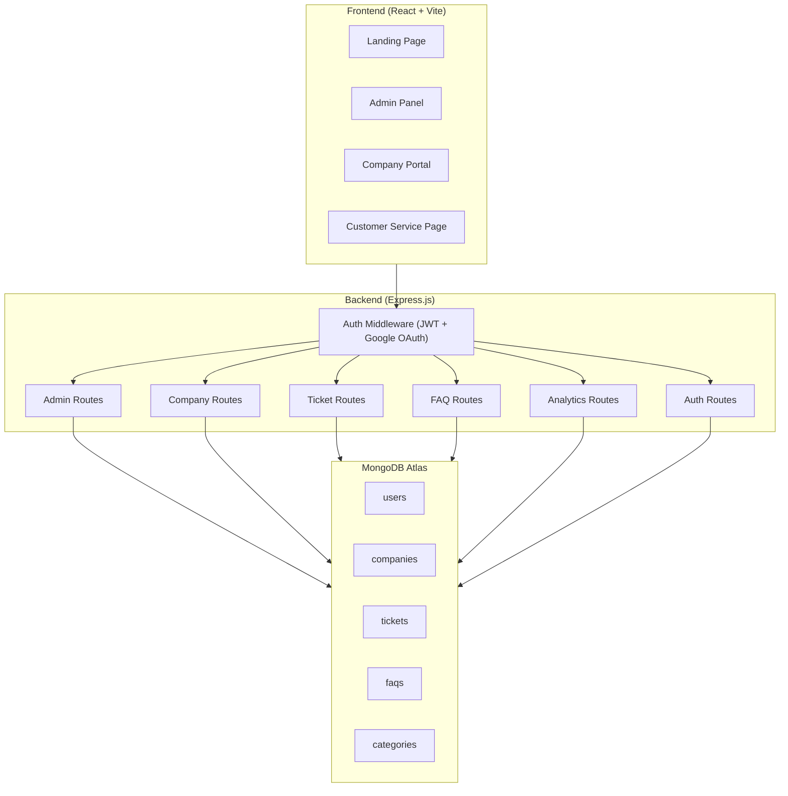
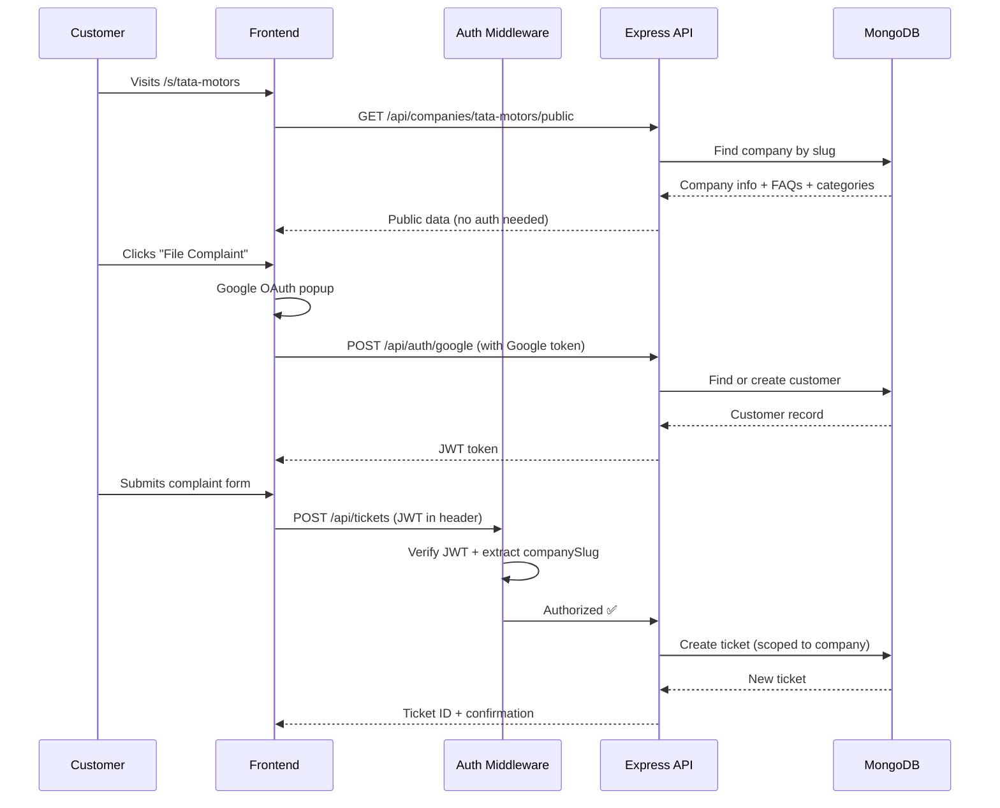
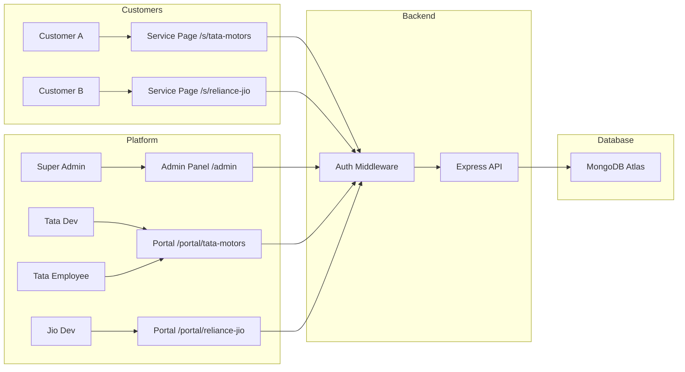

# 📋 ResolveIT v2 — Requirements & System Design Document

> **Project Type:** Academic (MERN Stack)
> **Architecture:** Multi-Tenant SaaS Customer Complaint Platform
> **Inspired By:** Jira Service Management, Zendesk, Freshdesk

---

## 1. Project Overview

**ResolveIT v2** is a multi-tenant customer complaint & support platform where:
- A **Super Admin** manages the entire platform
- **Companies** are onboarded by the Super Admin
- Each company gets a **Developer (Company Admin)** who customizes their own service page
- Developers can **hire/dismiss Employees** (support agents)
- **Customers** visit a company-specific URL, login with Google, and file complaints
- Each company's data is **completely isolated** — dashboards show only that company's data

---

## 2. User Roles & Permissions

### Role Hierarchy

```
Super Admin (God Mode)
    │
    ├── Company Developer (Company Admin)
    │       │
    │       ├── Employee (Support Agent)
    │       │
    │       └── Employee (Support Agent)
    │
    └── Company Developer (Company Admin)
            │
            └── Employee (Support Agent)

Customers ──── visit company service pages (Google login)
```

### Detailed Permission Matrix

| Feature | Super Admin | Company Developer | Employee | Customer |
|---|:---:|:---:|:---:|:---:|
| Create companies | ✅ | ❌ | ❌ | ❌ |
| Delete companies | ✅ | ❌ | ❌ | ❌ |
| Add company developers | ✅ | ❌ | ❌ | ❌ |
| Remove company developers | ✅ | ❌ | ❌ | ❌ |
| View all companies' dashboards | ✅ | ❌ | ❌ | ❌ |
| Platform-wide analytics | ✅ | ❌ | ❌ | ❌ |
| Add employees | ❌ | ✅ | ❌ | ❌ |
| Dismiss employees | ❌ | ✅ | ❌ | ❌ |
| Customize service page | ❌ | ✅ | ❌ | ❌ |
| Manage FAQs | ❌ | ✅ | ❌ | ❌ |
| Company branding settings | ❌ | ✅ | ❌ | ❌ |
| View company dashboard | ❌ | ✅ | ✅ | ❌ |
| View company tickets | ❌ | ✅ | ✅ | ❌ |
| Respond to tickets | ❌ | ✅ | ✅ | ❌ |
| Update ticket status | ❌ | ✅ | ✅ | ❌ |
| Escalate tickets | ❌ | ✅ | ✅ | ❌ |
| File a complaint | ❌ | ❌ | ❌ | ✅ |
| Track own tickets | ❌ | ❌ | ❌ | ✅ |
| Read FAQs | ❌ | ❌ | ❌ | ✅ |
| Rate resolution (CSAT) | ❌ | ❌ | ❌ | ✅ |

---

## 3. Multi-Tenant URL Structure

```
https://resolveit.com/                     → Landing page (public)
https://resolveit.com/admin                → Super Admin panel (protected)
https://resolveit.com/s/tata-motors        → Tata Motors service page (public)
https://resolveit.com/s/reliance-jio       → Reliance Jio service page (public)
https://resolveit.com/portal/tata-motors   → Tata Motors internal dashboard (developer + employees)
https://resolveit.com/portal/reliance-jio  → Reliance Jio internal dashboard (developer + employees)
```

### URL Breakdown

| Route Pattern | Who Sees It | Purpose |
|---|---|---|
| `/` | Everyone | Platform landing page |
| `/admin/*` | Super Admin only | Admin panel — manage companies & developers |
| `/s/:companySlug` | Customers (public) | Company-specific customer service page |
| `/s/:companySlug/track/:ticketId` | Customers | Track a specific complaint |
| `/portal/:companySlug/*` | Developer + Employees | Internal company dashboard |

---

## 4. Feature Specifications

### 4.1 Super Admin Panel (`/admin`)

#### 4.1.1 Super Admin Dashboard
- Total companies on platform
- Total tickets across all companies
- Total active employees across all companies
- Platform-wide resolution rate
- Company-wise comparison chart (bar chart — tickets per company)
- Recent activity feed (new companies, new tickets across platform)

#### 4.1.2 Company Management
- **Add Company** — form: company name, slug (auto-generated from name), logo upload, industry
- **View All Companies** — table with: name, slug, developer name, employee count, ticket count, status (active/suspended)
- **Edit Company** — update name, logo, suspend/activate
- **Delete Company** — soft delete (mark inactive), all data retained

#### 4.1.3 Developer Management
- **Add Developer** — form: name, email, password, assign to a company
- **View All Developers** — table with: name, email, assigned company, status
- **Remove Developer** — deactivate account (doesn't delete company data)

---

### 4.2 Company Developer Portal (`/portal/:companySlug`)

#### 4.2.1 Company Dashboard (shared view with employees)
- Total tickets for THIS company only
- Open / In Progress / Escalated / Resolved counts
- SLA compliance percentage
- Average CSAT score
- Tickets by category (pie/doughnut chart)
- Status distribution (bar chart)
- Recent tickets table
- High-priority escalation watchlist

#### 4.2.2 Ticket Management (shared with employees)
- View all company tickets in a searchable, filterable table
- Click a ticket to open detail view
- Change status: `Open` → `In Progress` → `Escalated` → `Resolved` → `Closed`
- Send replies to customer
- Add internal notes (visible only to agents, not customer)
- Escalate with reason
- View ticket timeline / audit trail

#### 4.2.3 Employee Management (Developer ONLY)
- **Add Employee** — form: name, email, password, department
- **View All Employees** — table with: name, email, department, tickets assigned, status
- **Dismiss Employee** — deactivate account, reassign their open tickets
- **Reinstate Employee** — reactivate a dismissed employee

#### 4.2.4 Service Page Customizer (Developer ONLY)
This is where the developer configures what customers see on `/s/:companySlug`

- **Company Branding:**
  - Company display name
  - Logo upload
  - Primary color / accent color
  - Welcome message / tagline

- **FAQ Manager:**
  - Add FAQ: question + answer (rich text)
  - Reorder FAQs (drag & drop or up/down arrows)
  - Edit / Delete FAQs
  - Toggle FAQ visibility (show/hide)
  - Categorize FAQs (e.g., "Billing", "Technical", "General")

- **Complaint Categories:**
  - Add/edit/remove the categories shown in the complaint form
  - e.g., "Billing Issue", "Product Defect", "Service Delay", "Technical Support"

- **Service Page Preview:**
  - Live preview of what the customer service page will look like

---

### 4.3 Customer Service Page (`/s/:companySlug`)

This is the **public-facing, company-branded** page that customers visit.

#### 4.3.1 Landing View (before login)
- Company logo + name + welcome message (from customizer)
- FAQ section with expandable accordion (from customizer)
- Search bar to filter FAQs
- "File a Complaint" CTA button → triggers Google login
- "Track Your Complaint" → enter ticket ID to check status (no login required, shows only status + timeline, no personal data)

#### 4.3.2 After Google Login
- **Complaint Form** opens with:
  - Customer name & email (auto-filled from Google profile)
  - Phone number (manual input)
  - Category dropdown (from company's configured categories)
  - Priority selector (Low / Medium / High / Critical)
  - Subject line
  - Description (textarea)
  - File attachments (optional, max 3 files, 5MB each)
  - Submit button

- **My Complaints** — list of all complaints this customer has filed with THIS company
  - Ticket ID, subject, status, date filed, last updated
  - Click to expand → see full timeline, messages from agent, and reply back
  - If resolved → option to rate (1-5 stars + optional feedback text)

---

### 4.4 Authentication Strategy

| User Type | Auth Method | Details |
|---|---|---|
| Super Admin | Email + Password | Single admin account, seeded at setup |
| Company Developer | Email + Password | Created by Super Admin |
| Employee | Email + Password | Created by Company Developer |
| Customer | **Google OAuth 2.0** | Signs in on the service page only |

---

## 5. System Design (Academic Level)

> [!NOTE]
> This is simplified for academic learning. Production systems would use microservices, message queues, Redis caching, etc. — we keep it monolithic & practical.

### 5.1 High-Level Architecture



### 5.2 Request Flow (Who Can Access What)



### 5.3 Auth Middleware Design

```
Every API request passes through:

1. Extract JWT from Authorization header
2. Verify & decode token
3. Check user role:
   - Super Admin → allow admin routes only
   - Developer → allow company routes for THEIR company only
   - Employee → allow ticket routes for THEIR company only
   - Customer → allow ticket routes for THEIR tickets only
4. Attach user + companyId to req object
5. Proceed to route handler
```

---

## 6. Database Design (MongoDB Schemas)

### 6.1 `users` Collection

```js
{
  _id: ObjectId,
  name: String,
  email: String,                    // unique
  password: String,                 // hashed (null for Google OAuth customers)
  googleId: String,                 // for Google OAuth customers
  avatar: String,                   // Google profile pic URL
  role: "superadmin" | "developer" | "employee" | "customer",
  company: ObjectId (ref: companies), // null for superadmin & customers
  department: String,               // for employees
  status: "active" | "dismissed",
  createdAt: Date,
  updatedAt: Date
}
```

### 6.2 `companies` Collection

```js
{
  _id: ObjectId,
  name: String,                     // "Tata Motors"
  slug: String,                     // "tata-motors" (unique, used in URL)
  logo: String,                     // URL or base64
  industry: String,                 // "Automotive"
  branding: {
    primaryColor: String,           // "#1a73e8"
    accentColor: String,            // "#fbbc04"
    welcomeMessage: String,         // "Welcome to Tata Motors Support"
    tagline: String                 // "We're here to help"
  },
  developer: ObjectId (ref: users), // the company developer
  status: "active" | "suspended",
  createdAt: Date,
  updatedAt: Date
}
```

### 6.3 `tickets` Collection

```js
{
  _id: ObjectId,
  ticketId: String,                 // "TATA-2026-0001" (auto-generated, company-prefixed)
  company: ObjectId (ref: companies),
  customer: {
    userId: ObjectId (ref: users),
    name: String,
    email: String,
    phone: String
  },
  category: String,                 // from company's configured categories
  priority: "Low" | "Medium" | "High" | "Critical",
  status: "Open" | "In Progress" | "Escalated" | "Resolved" | "Closed",
  subject: String,
  description: String,
  assignedTo: ObjectId (ref: users), // employee assigned
  slaDeadline: Date,                // computed from priority
  attachments: [{
    filename: String,
    url: String,
    size: Number
  }],
  messages: [{
    _id: ObjectId,
    sender: ObjectId (ref: users),
    senderRole: "customer" | "employee" | "developer",
    text: String,
    isInternal: Boolean,            // internal notes not visible to customer
    createdAt: Date
  }],
  timeline: [{
    action: String,                 // "Ticket Created", "Status Changed", "Escalated"
    by: String,                     // user name
    details: String,
    timestamp: Date
  }],
  csat: {
    rating: Number,                 // 1-5
    feedback: String,
    submittedAt: Date
  },
  createdAt: Date,
  updatedAt: Date
}
```

### 6.4 `faqs` Collection

```js
{
  _id: ObjectId,
  company: ObjectId (ref: companies),
  category: String,                 // "Billing", "Technical", etc.
  question: String,
  answer: String,
  order: Number,                    // for sorting
  isVisible: Boolean,               // developer can hide/show
  createdAt: Date,
  updatedAt: Date
}
```

### 6.5 `categories` Collection

```js
{
  _id: ObjectId,
  company: ObjectId (ref: companies),
  name: String,                     // "Billing Issue"
  description: String,              // "Problems related to charges, invoices, refunds"
  icon: String,                     // optional icon identifier
  isActive: Boolean,
  createdAt: Date
}
```

---

## 7. API Route Structure

### Auth Routes (`/api/auth`)
| Method | Endpoint | Auth | Description |
|---|---|---|---|
| POST | `/api/auth/login` | None | Email/password login (admin, dev, employee) |
| POST | `/api/auth/google` | None | Google OAuth (customers) |
| GET | `/api/auth/me` | JWT | Get current user session |
| POST | `/api/auth/logout` | JWT | Invalidate session |

### Admin Routes (`/api/admin`) — Super Admin only
| Method | Endpoint | Description |
|---|---|---|
| GET | `/api/admin/dashboard` | Platform-wide analytics |
| GET | `/api/admin/companies` | List all companies |
| POST | `/api/admin/companies` | Create a new company |
| PUT | `/api/admin/companies/:id` | Update company |
| DELETE | `/api/admin/companies/:id` | Suspend/delete company |
| POST | `/api/admin/developers` | Create company developer account |
| GET | `/api/admin/developers` | List all developers |
| DELETE | `/api/admin/developers/:id` | Remove developer |

### Company Routes (`/api/companies/:slug`) — Developer + Employees
| Method | Endpoint | Auth | Description |
|---|---|---|---|
| GET | `/api/companies/:slug/public` | None | Public info (branding, FAQs) for service page |
| GET | `/api/companies/:slug/dashboard` | Dev + Emp | Company analytics |
| PUT | `/api/companies/:slug/branding` | Dev only | Update branding |
| GET | `/api/companies/:slug/employees` | Dev only | List employees |
| POST | `/api/companies/:slug/employees` | Dev only | Add employee |
| PUT | `/api/companies/:slug/employees/:id` | Dev only | Update employee |
| DELETE | `/api/companies/:slug/employees/:id` | Dev only | Dismiss employee |

### FAQ Routes (`/api/companies/:slug/faqs`)
| Method | Endpoint | Auth | Description |
|---|---|---|---|
| GET | `/api/companies/:slug/faqs` | None | Get FAQs (public) |
| POST | `/api/companies/:slug/faqs` | Dev only | Add FAQ |
| PUT | `/api/companies/:slug/faqs/:id` | Dev only | Edit FAQ |
| DELETE | `/api/companies/:slug/faqs/:id` | Dev only | Delete FAQ |
| PUT | `/api/companies/:slug/faqs/reorder` | Dev only | Reorder FAQs |

### Ticket Routes (`/api/companies/:slug/tickets`)
| Method | Endpoint | Auth | Description |
|---|---|---|---|
| GET | `/api/companies/:slug/tickets` | Dev + Emp | All company tickets |
| GET | `/api/companies/:slug/tickets/mine` | Customer | Customer's own tickets |
| POST | `/api/companies/:slug/tickets` | Customer | File new complaint |
| GET | `/api/companies/:slug/tickets/:id` | Scoped | Ticket detail |
| PUT | `/api/companies/:slug/tickets/:id` | Dev + Emp | Update ticket |
| POST | `/api/companies/:slug/tickets/:id/messages` | All | Add message |
| POST | `/api/companies/:slug/tickets/:id/escalate` | Dev + Emp | Escalate ticket |
| POST | `/api/companies/:slug/tickets/:id/csat` | Customer | Submit rating |
| GET | `/api/companies/:slug/tickets/:id/track` | None | Public status check (limited data) |

### Category Routes (`/api/companies/:slug/categories`)
| Method | Endpoint | Auth | Description |
|---|---|---|---|
| GET | `/api/companies/:slug/categories` | None | List categories (public) |
| POST | `/api/companies/:slug/categories` | Dev only | Add category |
| PUT | `/api/companies/:slug/categories/:id` | Dev only | Edit category |
| DELETE | `/api/companies/:slug/categories/:id` | Dev only | Delete category |

---

## 8. Frontend Page Structure

```
src/
├── pages/
│   ├── LandingPage.jsx              ← Public homepage
│   ├── admin/
│   │   ├── AdminLayout.jsx          ← Sidebar + header wrapper
│   │   ├── AdminDashboard.jsx       ← Platform-wide stats
│   │   ├── CompanyManagement.jsx    ← CRUD companies
│   │   └── DeveloperManagement.jsx  ← CRUD developers
│   ├── portal/
│   │   ├── PortalLayout.jsx         ← Company portal wrapper
│   │   ├── PortalDashboard.jsx      ← Company-specific analytics
│   │   ├── TicketList.jsx           ← All company tickets
│   │   ├── TicketDetail.jsx         ← Single ticket view + messaging
│   │   ├── EmployeeManagement.jsx   ← Developer: add/dismiss employees
│   │   └── ServicePageCustomizer.jsx← Developer: branding + FAQs + categories
│   └── service/
│       ├── ServicePage.jsx          ← Customer-facing /s/:slug page
│       ├── ComplaintForm.jsx        ← File a complaint
│       ├── MyComplaints.jsx         ← Customer's ticket list
│       └── TrackTicket.jsx          ← Public ticket tracker
├── components/
│   ├── common/
│   │   ├── Navbar.jsx
│   │   ├── Sidebar.jsx
│   │   ├── Modal.jsx
│   │   ├── Table.jsx
│   │   ├── Chart.jsx
│   │   ├── Toast.jsx
│   │   └── ProtectedRoute.jsx      ← Role-based route guard
│   ├── dashboard/
│   │   ├── StatCard.jsx
│   │   ├── PieChart.jsx
│   │   ├── BarChart.jsx
│   │   └── EscalationWatch.jsx
│   └── service/
│       ├── FAQAccordion.jsx
│       ├── CategoryCard.jsx
│       └── CSATRating.jsx
├── context/
│   ├── AuthContext.jsx              ← Auth state + Google OAuth
│   └── CompanyContext.jsx           ← Current company data
├── hooks/
│   ├── useAuth.js
│   ├── useTickets.js
│   └── useCompany.js
├── utils/
│   ├── api.js                       ← Axios/fetch wrapper with JWT
│   ├── roles.js                     ← Permission helpers
│   └── sla.js                       ← SLA computation
└── App.jsx                          ← React Router setup
```

---

## 9. Tech Stack Summary

| Layer | Technology | Why |
|---|---|---|
| **Frontend** | React 19 + Vite | Fast dev, modern hooks |
| **Routing** | React Router v6 | Multi-page SPA with nested routes |
| **State** | React Context API | Simple enough for academic scope |
| **Charts** | Chart.js + react-chartjs-2 | Dashboard analytics |
| **Icons** | Lucide React | Clean, modern icons |
| **CSS** | Vanilla CSS (with CSS variables) | Full control, theme support |
| **Backend** | Express.js 5 + Node.js | REST API |
| **Database** | MongoDB Atlas + Mongoose | Document DB, flexible schemas |
| **Auth (Internal)** | JWT + bcryptjs | For admin, developer, employee |
| **Auth (Customer)** | Google OAuth 2.0 | One-click customer login |
| **File Uploads** | Multer + Cloudinary (or base64) | Ticket attachments, logos |
| **Deployment** | Vercel (frontend) + Render (backend) | Free tier friendly for academic |

---

## 10. Data Flow Diagram



---

## 11. SLA Rules (Academic Simplified)

| Priority | SLA Deadline | Auto-Escalate After |
|---|---|---|
| Critical | 4 hours | 2 hours |
| High | 12 hours | 8 hours |
| Medium | 24 hours | 18 hours |
| Low | 48 hours | 36 hours |

> SLA is computed as `createdAt + slaHours` and stored as `slaDeadline` in the ticket. Dashboard shows tickets nearing or past SLA.

---

## 12. Ticket ID Format

Each company gets its own prefix derived from the company slug:

```
TATA-2026-0001    (Tata Motors, year, sequential number)
JIO-2026-0001     (Reliance Jio)
HDFC-2026-0042    (HDFC Bank)
```

Format: `{COMPANY_PREFIX}-{YEAR}-{SEQUENTIAL_NUMBER}`

---

## 13. Seed Data (For Demo/Presentation)

Pre-populate the database with:
- 1 Super Admin account
- 2 sample companies (e.g., "TechNova Solutions", "QuickCart E-Commerce")
- 1 developer per company
- 2 employees per company
- 5 FAQs per company
- 10 tickets per company (mixed statuses & priorities)
- 3 customer accounts with Google mock data

---

## 14. Non-Functional Requirements

| Requirement | Target |
|---|---|
| Page load time | < 2 seconds |
| API response time | < 500ms |
| Concurrent users | ~50 (academic scale) |
| Data isolation | Strict per-company scoping |
| Password security | bcrypt 10 rounds |
| JWT expiry | 24 hours |
| File upload limit | 5MB per file, 3 files max |
| Browser support | Chrome, Firefox, Edge (latest) |
| Responsive | Desktop + Tablet (mobile optional) |

---

---

## 15. UI Design System (Carried from v1)

> The v1 design uses an **"Institutional Editorial"** aesthetic — warm linen tones, fine hairline borders, and premium serif + sans-serif typography. This MUST be retained in v2.

### 15.1 Google Fonts (4 Families)

```html
<link href="https://fonts.googleapis.com/css2?family=Cinzel:wght@500;600;700;800&family=Newsreader:ital,opsz,wght@0,6..72,400;0,6..72,500;0,6..72,600;0,6..72,700;1,6..72,400&family=Plus+Jakarta+Sans:wght@300;400;500;600;700&family=JetBrains+Mono:wght@400;500;600&display=swap" rel="stylesheet">
```

| CSS Variable | Font Family | Usage |
|---|---|---|
| `--font-display` | **Cinzel** (serif) | Logo, brand name, major headings — gives the formal, institutional feel |
| `--font-serif` | **Newsreader** (serif), fallback: Lora, Georgia | Section titles, editorial headings, article body text |
| `--font-sans` | **Plus Jakarta Sans** (sans-serif), fallback: system fonts | Body text, labels, buttons, form inputs — primary readable font |
| `--font-mono` | **JetBrains Mono** (monospace) | Ticket IDs, codes, technical values |

### 15.2 Color Palette — Light Mode

#### Backgrounds
| CSS Variable | Hex | Name | Usage |
|---|---|---|---|
| `--bg-main` | `#f5f2eb` | Natural Raw Linen | Page background |
| `--bg-subtle` | `#eae5db` | Muted Sand Surface | Section backgrounds, sidebar |
| `--bg-card` | `#faf8f5` | Ivory Linen Surface | Cards, modals, elevated surfaces |
| `--bg-surface` | `#ebe6dc` | Warm Slate Stone | Input backgrounds, table headers |
| `--bg-surface-hover` | `#e2dcce` | Subtle Hover | Hover states on surfaces |

#### Text
| CSS Variable | Hex | Name | Usage |
|---|---|---|---|
| `--text-main` | `#181716` | Deep Editorial Charcoal | Headings, primary text |
| `--text-body` | `#383531` | Warm Slate Body | Body text, descriptions |
| `--text-muted` | `#6b645b` | Refined Taupe Grey | Secondary labels, captions |
| `--text-dim` | `#9c9488` | Soft Stone | Placeholders, disabled text |

#### Borders
| CSS Variable | Hex | Name | Usage |
|---|---|---|---|
| `--border-color` | `#ded6c7` | Crisp Hairline Border | Card borders, dividers |
| `--border-dark` | `#bfb5a3` | Outer Framing Border | Strong dividers, table borders |
| `--border-focus` | `#2e2b28` | Deep Charcoal Focus | Focus rings on inputs |

#### Primary
| CSS Variable | Hex | Usage |
|---|---|---|
| `--primary` | `#25221f` | Primary buttons, active states |
| `--primary-hover` | `#121110` | Primary button hover |
| `--primary-light` | `#eae4d8` | Primary tint backgrounds |

#### Semantic Accent Colors
| CSS Variable | Hex | Name | Semantic Usage |
|---|---|---|---|
| `--bronze` | `#8c6a46` | Antique Muted Bronze | Branding accents, highlights |
| `--bronze-light` | `#f7f1e8` | — | Bronze tint background |
| `--sage` | `#446450` | Muted Forest Sage | ✅ Resolved / Settled / Success |
| `--sage-light` | `#eef4f0` | — | Sage tint background |
| `--amber` | `#8e6223` | Warm Umber | ⏳ Under Investigation / Warning |
| `--amber-light` | `#faf4ea` | — | Amber tint background |
| `--brick` | `#8c3838` | Terracotta Brick | 🔴 Critical / Escalated / Error |
| `--brick-light` | `#faecec` | — | Brick tint background |
| `--taupe` | `#696258` | Taupe | Neutral / info badges |
| `--taupe-light` | `#efebe3` | — | Taupe tint background |

### 15.3 Color Palette — Dark Mode

| CSS Variable | Light | Dark | Notes |
|---|---|---|---|
| `--bg-main` | `#f5f2eb` | `#141312` | Deep warm black |
| `--bg-subtle` | `#eae5db` | `#1c1b19` | Slightly elevated |
| `--bg-card` | `#faf8f5` | `#1f1d1b` | Card surfaces |
| `--bg-surface` | `#ebe6dc` | `#272522` | Input/table backgrounds |
| `--bg-surface-hover` | `#e2dcce` | `#33302b` | Hover states |
| `--text-main` | `#181716` | `#f5f1e8` | Inverted — warm white |
| `--text-body` | `#383531` | `#ded6c7` | Inverted |
| `--text-muted` | `#6b645b` | `#a39b8d` | Lighter muted |
| `--text-dim` | `#9c9488` | `#756d61` | Dimmer |
| `--border-color` | `#ded6c7` | `#33302b` | Subtle in dark |
| `--border-dark` | `#bfb5a3` | `#47433c` | Stronger border |
| `--border-focus` | `#2e2b28` | `#c2b7a3` | Inverted focus |
| `--primary` | `#25221f` | `#ded4c3` | Inverted primary |
| `--bronze` | `#8c6a46` | `#cca172` | Brighter bronze |
| `--sage` | `#446450` | `#7da48b` | Brighter sage |
| `--amber` | `#8e6223` | `#cf9b4a` | Brighter amber |
| `--brick` | `#8c3838` | `#d46f6f` | Brighter brick |
| `--taupe` | `#696258` | `#b0a89c` | Lighter taupe |

### 15.4 Shadows, Radii & Transitions

```css
/* Shadows — Minimal natural depth, warm undertone */
--shadow-xs: 0 1px 2px rgba(35, 30, 25, 0.03);
--shadow-sm: 0 2px 6px rgba(35, 30, 25, 0.04);
--shadow-md: 0 6px 18px rgba(35, 30, 25, 0.06);
--shadow-lg: 0 14px 32px rgba(35, 30, 25, 0.08);

/* Border Radius — Tight, institutional (NOT rounded/bubbly) */
--radius-sm: 2px;
--radius-md: 4px;
--radius-lg: 6px;

/* Transitions */
--transition-fast: 0.12s ease;
--transition-normal: 0.2s ease-out;
```

### 15.5 Typography Rules

| Element | Font | Weight | Size | Tracking |
|---|---|---|---|---|
| Brand/Logo | `--font-display` (Cinzel) | 600–700 | 14–18px | `0.15em` (wide letter-spacing) |
| Page Titles (h1) | `--font-serif` (Newsreader) | 600 | 28–32px | Normal |
| Section Headers (h2) | `--font-display` (Cinzel) | 600 | 11–13px | `0.08–0.12em` (uppercase spaced) |
| Body Text | `--font-sans` (Plus Jakarta Sans) | 400 | 15px (base) | Normal |
| Labels / Captions | `--font-sans` | 500–600 | 11–12px | `0.04em` |
| Buttons | `--font-sans` | 600 | 13–14px | `0.02em` |
| Ticket IDs / Codes | `--font-mono` (JetBrains Mono) | 500 | 12–13px | Normal |
| Badge Text | `--font-sans` | 600 | 10–11px | `0.06em` (uppercase) |

### 15.6 Status Badge Color Mapping

| Status | Background | Text Color | Border |
|---|---|---|---|
| Open | `--taupe-light` | `--taupe` | `--taupe` at 30% opacity |
| In Progress | `--amber-light` | `--amber` | `--amber` at 30% opacity |
| Escalated | `--brick-light` | `--brick` | `--brick` at 30% opacity |
| Resolved | `--sage-light` | `--sage` | `--sage` at 30% opacity |
| Closed | `--bg-surface` | `--text-muted` | `--border-color` |

### 15.7 Priority Badge Color Mapping

| Priority | Background | Text Color |
|---|---|---|
| Low | `--taupe-light` | `--taupe` |
| Medium | `--amber-light` | `--amber` |
| High | `--amber-light` | `--amber` (bold) |
| Critical | `--brick-light` | `--brick` |

### 15.8 Design Principles (Carry Forward)

1. **Warm, not cold** — No pure whites (`#fff`) or pure blacks (`#000`). Always warm-tinted.
2. **Fine hairline borders** — Thin `1px` borders, never thick or heavy.
3. **Tight border radius** — Max `6px`. No pill shapes or fully rounded corners.
4. **Uppercase spaced labels** — Section headers use `text-transform: uppercase` with wide `letter-spacing`.
5. **Minimal shadows** — Very subtle, warm-tinted shadows. The design relies on borders, not shadows.
6. **Editorial serif for headings** — Cinzel for brand, Newsreader for editorial titles.
7. **Clean sans-serif for UI** — Plus Jakarta Sans for everything interactive.
8. **Base font size: 15px** — Slightly larger than default for readability.
9. **Line height: 1.7** — Generous for comfortable reading.
10. **Anti-aliased rendering** — `-webkit-font-smoothing: antialiased` always.

---

> [!IMPORTANT]
> **Next Step:** Once requirements are approved, build the project module-by-module:
> 1. Backend setup (Express + MongoDB + Auth middleware)
> 2. Database models & seed data
> 3. API routes with role-based protection
> 4. Frontend routing & layouts
> 5. Admin panel
> 6. Company portal + dashboards
> 7. Customer service page + Google OAuth
> 8. Service page customizer
> 9. Polish, testing & deployment
